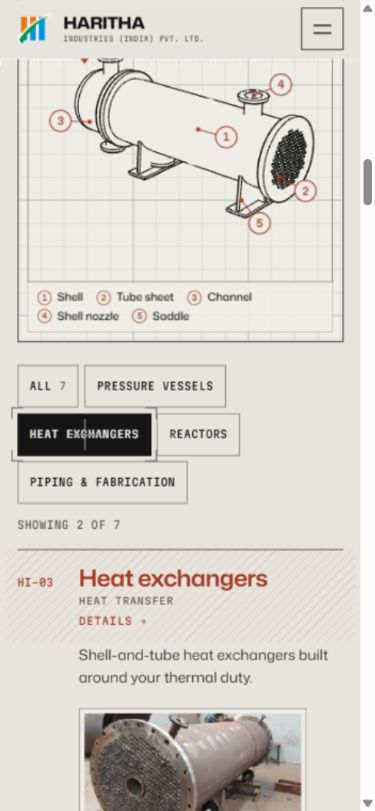
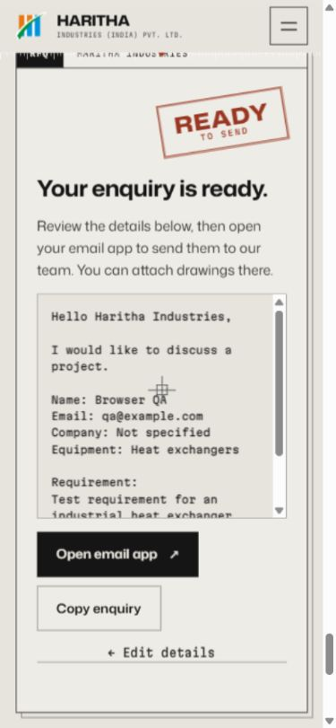
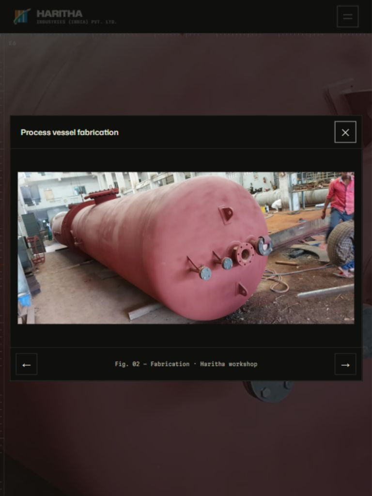
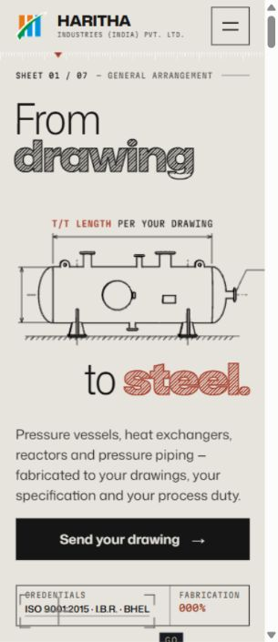

# Browser review and refinement

Verified locally in the Chromium in-app browser on 19 October 2026.

## Viewports inspected

| Viewport | Coverage |
| --- | --- |
| 1440 × 900 | Hero, catalogue, filters, product dialog |
| 768 × 1024 | Navigation, credentials, document viewer, workshop gallery |
| 390 × 844 | Hero, navigation, catalogue, product-to-enquiry flow, enquiry review and editing |
| 320 × 740 | Hero, compact typography, catalogue layout |
| 844 × 390 | Landscape hero before and after refinement |

## Findings resolved

- Mobile equipment rows expanded and collapsed during scrolling/focus, moving the tap target. Descriptions and photographs now stay expanded below 960px; the illustration scrolls with the page instead of covering controls. Pointer activation of product details passed after the change.
- Mobile product buttons hid their Details affordance. The action is now visible, and equipment filters have 44px minimum height.
- The enquiry form's grid display overrode its hidden attribute. The review state now hides the form; editing restores the entered values. Product selection correctly carries into the enquiry and generated mailto content.
- The open navigation allowed keyboard focus to escape. The page and footer become inert while it is open; Tab wraps to the toggle, Shift+Tab wraps to the last link, and Escape closes it.
- The image viewer close glyph was positioned outside its button. The button now anchors the glyph; gallery and certificate navigation passed.
- Landscape hero text overlapped on short screens. A taller scrollable sheet separates the layers. Compact-phone sheet labels and credentials were also adjusted.
- Enquiry review could appear above the visible area after the form collapsed. It now scrolls into view, with its stamp and heading laid out without overlap.

## Validation

- `npm run build`: passed.
- `git diff --check`: passed.
- Browser console: no captured warnings or errors during the checked flows.
- No broken loaded images found in the final asset check.
- No document horizontal overflow at the measured phone, tablet, and desktop sizes.
- Enquiry preparation used sample data only; no email was sent.

Follow-up: the Three.js bundle warning is resolved by separating its core (219.65 kB minified, 60.16 kB gzip) and renderer (337.54 kB minified, 81.79 kB gzip). Equipment code is now 35.97 kB minified. The existing 500 kB warning threshold is unchanged. The production preview rendered both the hero and equipment viewer, switched to the reactor model, and logged no browser warnings or errors. Three.js remains behind dynamic scene imports, with no Three.js preload in the initial HTML.

This review did not measure network performance, test other browser engines or physical touch devices, or establish full accessibility compliance. Reduced-motion behavior was not browser-emulated in this pass.

## Saved evidence

